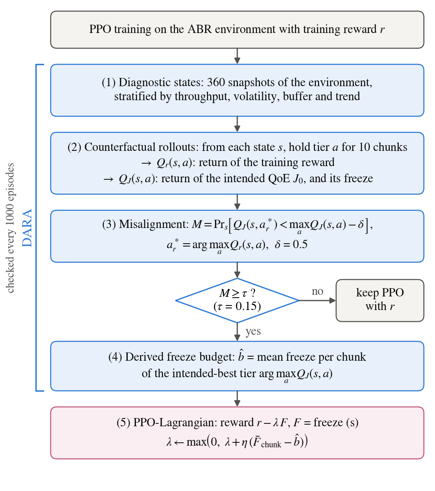

# DARA: Reward Diagnosis for RL-based Adaptive Bitrate Streaming on 5G mmWave

[](https://github.com/sachinthafernando/dara-abr/actions/workflows/ci.yml)


Code, experiment definitions and results for the MSc by Research thesis *Deep Reinforcement Learning for Adaptive
Bitrate Streaming in 5G mmWave Networks* (University of Hertfordshire, 2026) and the conference paper *DARA: Improving
RL-based adaptive bitrate streaming through reward diagnosis*.

Like [Pensieve](https://github.com/hongzimao/pensieve), the repository is meant to be downloaded and run. It supports
three levels of reproduction:

| Level | What you get | Needs | Time |
|---|---|---|---|
| **1. Inspect** | every number of the paper and thesis, from the shipped result files; your own analysis on 69,600 per-session scores | pandas | 1 min |
| **2. Smoke test** | every code path of the pipeline (environment, BC, PPO, DARA, baselines, evaluation) | PyTorch, CPU | 20 s – 5 min per job |
| **3. Full reproduction** | all 360 training runs and the evaluation jobs, then every table and figure rebuilt | PyTorch, GPU cluster (SLURM optional), datasets | ~480 GPU jobs |

<p align="center"></p>

## What DARA does

An RL agent for adaptive bitrate (ABR) streaming learns from a *training reward*. On mmWave 5G with large bitrate
ladders, that reward can prefer tiers that are bad under the *intended* QoE. When it does, PPO learns to stall, for
minutes per session.

DARA detects this before and during training, from counterfactual fixed-tier rollouts that need no policy:

1. It takes 360 stratified snapshots of the environment.
2. From each snapshot it holds every tier for 10 chunks.
3. It computes the misalignment *M*: the share of states where the training reward's preferred tier is worse than the
   intended-best tier by more than δ = 0.5.
4. If M ≥ τ = 0.15 on two consecutive checks (one check every 1,000 sessions), it switches on a freeze constraint.

The constraint's budget b̂ is the freeze per chunk of the intended-best tier. It is enforced with PPO-Lagrangian
(η = 0.05), so the budget needs no hand tuning.

> **Naming.** The method called **DARA** in the paper and thesis is `dara_online_lag` in the code and **DARA-L** in
> the generated reports, tables and figures. `dara_online` ("DARA, cap only") is an ablation. The code is kept
> byte-identical to the version that produced the results (see [Provenance](#provenance)), so the labels were not
> changed.

## Key results

The table below comes from [`results/BENCHMARK.md`](results/BENCHMARK.md), which
`python scripts/analysis/benchmark_summary.py` regenerates. Values are the mean QoE *J*₀ per session over 100 shared
test sessions (higher is better); learned methods show mean ± s.d. over 5 training seeds. Rows are ordered by the
misalignment *M* of the original reward.

| Training network | Ladder | *M* | **DARA** | PPO-Lag. (0.5 s) | Best hand-picked budget¹ | COREL | Pensieve | RobustMPC | PPO, original reward |
|---|---|---|---|---|---|---|---|---|---|
| mmWave generator | ×1 | 0.16 | **287.5 ± 5.1** | 285.4 ± 7.2 | 290.5 ± 5.9 (0.25 s) | 260.0 ± 7.6 | 259.4 ± 18.1 | 223.2 | 284.9 ± 7.6 |
| Lumos5G (real) | ×4 | 0.23 | **253.8 ± 2.5** | 232.4 ± 1.4 | 232.4 ± 1.4 (0.5 s) | 259.1 ± 4.3 | 246.7 ± 12.1 | 219.5 | – |
| mmWave generator | ×2 | 0.33 | **238.1 ± 8.8** | 247.7 ± 3.9 | 247.9 ± 4.1 (0.25 s) | 191.7 ± 19.6 | 204.2 ± 14.5 | 186.7 | 220.5 ± 2.8 |
| Irish 5G static | ×1 | 0.37 | **220.9 ± 6.3** | 226.9 ± 4.5 | 226.9 ± 4.5 (0.5 s) | – | – | 196.2 | – |
| mmWave generator | ×4 | 0.57 | **188.7 ± 4.6** | 192.1 ± 3.6 | 192.1 ± 3.6 (0.5 s) | 174.7 ± 22.4 | 145.6 ± 19.5 | 147.1 | 65.9 ± 9.3 |
| mmWave generator | ×8 | 0.75 | **100.2 ± 10.4** | 117.6 ± 30.8 | 129.8 ± 7.0 (1 s) | 122.5 ± 6.4 | 98.2 ± 9.7 | 104.9 | −261.7 ± 19.5 |
| Harsh mmWave | ×4 | 0.78 | **99.8 ± 11.2** | 129.8 ± 7.4 | 136.9 ± 5.2 (1 s) | 110.8 ± 19.5 | 69.7 ± 3.1 | 95.1 | – |
| Irish 5G driving | ×1 | 0.85 | **88.8 ± 9.6** | 101.5 ± 13.2 | 101.5 ± 13.2 (0.5 s) | 69.9 ± 24.7 | 71.5 ± 9.1 | 120.5 | – |

¹ The best of 1–4 PPO-Lagrangian budgets, each a full training run, chosen *afterwards* on the test sessions. This is
an oracle reference: DARA picks its budget during training, without any search.

- **The diagnosis predicts failure.** *M*, measured before training, ranks the shortfall of plain PPO with Spearman
  ρ = 0.87 (95% CI 0.78–0.92, 22 reward settings). Settings DARA flags fell short of the best fixed tier by 93% on
  average; unflagged settings fell short by 1.1%.
- **It removes the failure.** On the primary environment (generator ×4), plain PPO scores *J*₀ = 65.9 with 244.5 s of
  freezing per session. DARA scores 188.7 with 25.6 s.
- **It needs no budget search.** DARA is within 1–4% of the best hand-picked budget on generator ×1, ×2 and ×4 and on
  Irish 5G static. On Lumos5G it beats that budget by 9%.
- **It freezes less.** DARA freezes less than PPO-Lagrangian (0.5 s) in 7 of 8 training environments; the freeze
  table is in [`BENCHMARK.md`](results/BENCHMARK.md).
- **It transfers.** The generator-×1 models were tested on Lumos5G, Irish 5G (static and driving), harsh mmWave and
  an unseen ×4 ladder, without retraining. In paired session-level tests recomputed from the shipped session files,
  DARA beats PPO-Lagrangian (0.5 s), COREL or Pensieve in 23 of 30 comparisons (Wilcoxon, Benjamini–Hochberg
  q < 0.05).

The gap to the best hand-picked budget is largest where *M* is highest: ×8, harsh mmWave and Irish 5G driving. The
thesis discusses these cases (Chapters 5–6).

## Repository layout

```
dara-abr/
├── notebooks/dara_abr.ipynb        environment, BC + PPO, DARA, baselines, evaluation (run by papermill)
├── src/dara_abr/                   mmWave network generator, experiment registry, statistics, result loaders
├── configs/
│   ├── preregistration/            evaluation rules fixed before the runs (seeds, tests, comparisons)
│   └── sweeps/*.tsv                job tables: one row = one notebook execution
├── scripts/
│   ├── data/                       dataset checks, trace preparation, content-model calibration
│   ├── sweeps/make_sweeps.py       writes the job tables from the registry
│   ├── hpc/                        SLURM array scripts, local runner, job checker
│   └── analysis/                   statistics, tables, figures, HTML report, benchmark summary
├── data/                           dataset links and layout; processed/content_params.json, MANIFEST.json
├── results/                        shipped: every result table (CSV / LaTeX / Markdown)
│   ├── BENCHMARK.md                the benchmark summary
│   ├── views/t015/                 results at act threshold τ = 0.15: the values in the paper and thesis
│   ├── training/, generalisation/  pre-registered analysis (τ = 0.2), kept for transparency
│   └── sessions/                   per-session scores of the transfer and per-scenario experiments
├── figures/                        shipped: paper figures (figures/paper/), report figures
├── overview/views/t015/index.html  shipped: self-contained HTML report of every result
├── docs/                           PIPELINE.md, REPRODUCING.md, RELEASE_NOTES_v1.0.0.md, PUBLISHING.md
└── tests/                          result regression tests, held-out-trace test, synthetic fixtures
```

`runs/` and `logs/` are created when you train or evaluate. They hold checkpoints and per-run logs, and are not part
of the repository.

## Installation

You need Python 3.9 or later. The original runs used Python 3.9 with CUDA PyTorch on an HPC cluster. This release was
also checked end to end with Python 3.13 and PyTorch 2.15 on CPU.

```bash
git clone https://github.com/sachinthafernando/dara-abr.git
cd dara-abr
python -m venv .venv && source .venv/bin/activate        # Windows: .venv\Scripts\activate

pip install -r requirements-analysis.txt                 # level 1 only: no PyTorch needed

pip install torch                                        # levels 2-3: the build for your platform, see pytorch.org
pip install -r requirements.txt
python -m ipykernel install --user --name python3        # papermill runs the notebook with this kernel
```

With conda, run `conda env create -f environment.yml && conda activate dara-abr` instead. A `Makefile` wraps the
common commands; `make help` lists them.

## Level 1: inspect the results

This needs no GPU and no datasets, and takes about a minute.

```bash
python scripts/analysis/benchmark_summary.py    # writes results/BENCHMARK.md and results/benchmark/*.csv
pytest                                          # checks the shipped files against the published numbers
```

Next, open **`overview/views/t015/index.html`** in a browser. It is the full results report: every environment,
statistical test and figure, each with the numbers behind it.

| File | Contents |
|---|---|
| `results/views/t015/training/training_table.csv` | *J*₀, seed s.d., freeze, mean tier, budget and final λ for every method × training environment |
| `results/views/t015/training/training_tests.csv` | DARA against every comparison: Wilcoxon (sessions), Welch (seeds), hierarchical-bootstrap CI, BH q, verdict |
| `results/views/t015/training/budget_test.csv` | DARA's derived budget against the curve of hand-picked budgets |
| `results/views/t015/training/diagnosis_validity*.csv` | *M* against the shortfall of plain PPO, with Spearman ρ and bootstrap CI |
| `results/generalisation/gen_*.csv` | the ×4 models on unseen networks and ladders |
| `results/sessions/transfer_ct1_sessions.csv.gz` | 41,000 test sessions: ×1 models on 5 networks × 2 ladders, one row per session |
| `results/sessions/scenarios_ct1_sessions.csv.gz` | 28,600 test sessions: ×1 models per generator scenario and scenario group |
| `figures/paper/` | paper figures (PDF/PNG), `table1.*`, `captions.md`, transfer, scenario and switching tables and tests |
| `results/tables/` | LaTeX tables (`table_training.tex`, `table_budget.tex`, `table_generalisation.tex`, ...) |

The session files are enough for your own analysis. For example:

```python
import pandas as pd
s = pd.read_csv("results/sessions/transfer_ct1_sessions.csv.gz")
s = s[s.method == "policy"].assign(algo=s.run.str.split("__").str[1].str.replace(r"_s\d+$", "", regex=True))
print(s.groupby(["network", "content", "algo"]).J0.mean().unstack().round(1))
```

## Level 2: smoke test

The mmWave generator is synthetic, so the generator environments `ct1`, `ct2`, `ct4`, `ct8` and `cth4` need **no
dataset**.

```bash
python scripts/sweeps/make_sweeps.py                                   # writes configs/sweeps/*.tsv
bash scripts/hpc/run_local.sh configs/sweeps/smoke_train.tsv 1 6       # ct4: PPO, DARA variants, PPO-Lag., Pensieve, COREL
bash scripts/hpc/run_local.sh configs/sweeps/smoke_train.tsv 8 8       # diagnosis landscape (M, D), no training
```

Each job runs the notebook with `SMOKE=1`: a few episodes through every code path, written to `runs/smoke/`. The
executed notebook is saved to `logs/executed/<run>.ipynb`.

Job 7 of `smoke_train.tsv` (Irish 5G static), `smoke_v2.tsv` and `smoke_generalise.tsv` need the real-trace datasets (see
[Datasets](#datasets)). Run `smoke_generalise.tsv` after `smoke_train.tsv`, because it uses those checkpoints.

The statistics run on the smoke outputs as well. Expect meaningless numbers, from one seed and a few episodes:

```bash
python scripts/analysis/evaluate_training.py --runs runs/smoke/train --out runs/smoke/analysis --n-boot 50
```

Every parameter of a run is one row of a job table; `python scripts/hpc/row_args.py <table.tsv> <row>` prints them.

## Level 3: full reproduction

The study has 360 training runs (8 training environments, up to 15 methods, 5 seeds each). It also has about 80
evaluation-only jobs on unseen networks and scenarios, plus the diagnosis landscape and two prechecks.

On the original cluster each job had one GPU and a 3-hour limit. Training on a GPU is not bit-for-bit deterministic,
so a re-run matches the published values within the seed spread, not to the last digit.

**1. Datasets.** These are needed only for the real-trace environments and the unseen-network tests. Download them
(see [Datasets](#datasets)), then:

```bash
python scripts/data/inspect_datasets.py && python scripts/data/prepare_traces.py && python scripts/data/analyse_traces.py
```

`prepare_traces.py` writes the md5 of every source file to `data/processed/MANIFEST.json`. Compare it with the
shipped file (`git diff data/processed/MANIFEST.json`) to confirm you have the same data.

**2. Job tables and submission.** With SLURM, each table is one array job and each row is one array task:

```bash
python scripts/sweeps/make_sweeps.py
mkdir -p logs/slurm                                         # SLURM writes the job logs here
submit() { sbatch --array=1-$(($(wc -l < "$1")-1)) --export=ALL,TSV="$1",DARA_VENV="$PWD/.venv" scripts/hpc/run_sweep.slurm; }
submit configs/sweeps/smoke_train.tsv                       # first: every code path
submit configs/sweeps/landscape.tsv; submit configs/sweeps/main.tsv; submit configs/sweeps/other_envs.tsv
python scripts/sweeps/make_sweeps.py --skip-done            # drops finished runs (set1/set2 overlap main/other_envs)
submit configs/sweeps/precheck.tsv; submit configs/sweeps/set1.tsv; submit configs/sweeps/set2.tsv
submit configs/sweeps/generalise.tsv; submit configs/sweeps/generalise_ct1.tsv; submit configs/sweeps/scenarios_ct1.tsv
python scripts/hpc/check_jobs.py configs/sweeps/set1.tsv    # finished and failed jobs, and the --array list to re-run
```

Adapt the `#SBATCH` lines of `scripts/hpc/run_sweep.slurm` (partition, GPU, time limit) to your cluster, or use
`run_sweep_cpu.slurm` on CPU nodes. Without SLURM, run `bash scripts/hpc/run_local.sh <table.tsv>`.

| Table | Jobs | Purpose |
|---|---|---|
| `smoke_train`, `smoke_generalise`, `smoke_v2` | 8, 3, 5 | every code path, 20 s – 5 min each on a CPU |
| `landscape` | 1 | *M* and dominance *D* over reward cap × ladder (no training) |
| `main` | 75 | generator ×4: 15 methods × 5 seeds |
| `other_envs` | 75 | DARA and hand-picked budgets on ×2, harsh mmWave and Irish static |
| `set1`, `set2` | 225, 60 | ladders ×1–×8; harsh mmWave, Irish driving, Lumos5G (85 runs repeat `main`/`other_envs`) |
| `precheck` | 2 | *M* before training on Irish driving and Lumos5G |
| `generalise`, `generalise_ct1`, `scenarios_ct1` | 26, 26, 21 | trained models on unseen networks, ladders and scenarios |
| `ablations`, `generalise_budgets` | 10, 15 | optional |

**3. Analysis.** These commands rebuild `results/`, `figures/` and `overview/` from `runs/`. Afterwards, `git diff`
shows how your numbers differ from the shipped ones.

```bash
bash scripts/analysis/run_all.sh                            # statistics, tables, figures, HTML report (τ = 0.2)
python scripts/analysis/threshold_view.py --threshold 0.15  # the τ = 0.15 view used in the paper and thesis
python scripts/analysis/make_paper.py                       # figures/paper/: Fig. 1-8, Table I, captions
python scripts/analysis/benchmark_summary.py                # results/BENCHMARK.md
```

[`docs/PIPELINE.md`](docs/PIPELINE.md) describes every script, option and output, including the session timeline,
the per-scenario and transfer figures, and the held-out-trace protocol. [`docs/REPRODUCING.md`](docs/REPRODUCING.md)
maps each result of the paper and thesis to the command and file that produce it.

## Datasets

The third-party datasets are **not redistributed**. Please download them from their sources:

| Dataset | Used for | Licence | Link | Place at |
|---|---|---|---|---|
| **Lumos5G v1.0** (Narayanan et al., IMC 2020) | real mmWave training and test network; generator calibration | CC BY 4.0 | [IEEE DataPort](https://ieee-dataport.org/node/3598) (free login) · [project page](https://lumos5g.umn.edu/) | `data/raw/lumos5g/Lumos5G-v1.0.csv` |
| **Irish 5G production dataset** (Raca et al., MMSys 2020) | commercial 5G traces, static and driving | GPL-3.0 | [github.com/uccmisl/5Gdataset](https://github.com/uccmisl/5Gdataset) | `data/raw/irish5g/` (unzipped) |
| **Puffer `video_size`** (Yan et al., NSDI 2020) | only to re-calibrate the chunk-size model | see site | [puffer.stanford.edu/results](https://puffer.stanford.edu/results/) | `data/raw/puffer/` |

```bash
mkdir -p data/raw/lumos5g data/raw/irish5g
unzip Lumos5G-v1.0.zip -d data/raw/lumos5g                  # downloaded from IEEE DataPort
git clone --depth 1 https://github.com/uccmisl/5Gdataset /tmp/5Gdataset
unzip /tmp/5Gdataset/5G-production-dataset.zip -d data/raw/irish5g
```

[`data/README.md`](data/README.md) lists the expected columns and the cleaning steps. If your copy has a different
layout, edit `scripts/data/dataset_spec.json`. The calibrated chunk-size model, `data/processed/content_params.json`,
is included, so you do not need Puffer to reproduce the results.

## Environments and methods

| Code | Training network | Ladder |
|---|---|---|
| `ct1`, `ct2`, `ct4`, `ct8` | mmWave generator (calibrated on Lumos5G) | ×1, ×2, ×4, ×8 |
| `cth4` | harsh mmWave scenarios of the generator | ×4 |
| `ctl` | Lumos5G traces (20% held out for testing) | ×4 |
| `cts1` | Irish 5G static traces | ×1 |
| `ctd1` | Irish 5G driving traces (25% held out for testing) | ×1 |

| Code | Method |
|---|---|
| `dara_online_lag` | **DARA**: diagnosis, then PPO-Lagrangian with the derived budget |
| `ppo_lagrangian_t{0.125, 0.25, 0.5, 1, 2}` | PPO-Lagrangian with a hand-picked freeze budget (s per chunk) |
| `corel_official` | COREL, re-implemented from the official recipe |
| `pensieve_official` | Pensieve (A3C), re-implemented from the official recipe |
| `robustmpc` | RobustMPC |
| `fixed`, `cap0.25` … `cap5`, `ppo_ref_reward` | PPO on the original reward (cap c = 0.1), on other freeze-penalty caps, and on the *J*₀ terms |

Every learned method uses behaviour cloning followed by PPO, with a 6-encoder actor-critic of 97,494 parameters. The
training reward caps the freeze penalty at c = 0.1 and is clipped to [−60, 7].

The intended QoE per session is *J*₀ = Σ q(tier) − 1.075·freeze(s) − Σ|Δq|, with q = (1.00, 1.92, 2.61, 3.30, 4.00).

Training seeds are 101, 202, 303, 404 and 505. The 100 test sessions are drawn with evaluation seed 99, so every
method sees the same sessions. Every comparison is reported three ways:

- a Wilcoxon signed-rank test on sessions, with Benjamini–Hochberg correction;
- a Welch test on seed means;
- a hierarchical-bootstrap CI.

These rules were frozen before the runs, in `configs/preregistration/`.

## Provenance

- **Notebook.** The results were produced by `notebooks/dara_abr.ipynb`, md5 `9d323ac8b76368b3a28e6cc3b0407023`. The
  file in this repository is that notebook, unchanged; check it with `md5sum notebooks/dara_abr.ipynb`.
- **Code.** The source and analysis scripts are as they were on the HPC cluster when the results were produced. This
  release adds documentation, `benchmark_summary.py`, tests, CI and packaging files; see
  [`CHANGELOG.md`](CHANGELOG.md).
- **Threshold.** The paper and thesis report the **τ = 0.15 view** (`results/views/t015/`, `overview/views/t015/`).
  The act threshold was lowered from the pre-registered 0.2 after the first results were seen. Both analyses are
  shipped, and the HTML report marks the difference.
- **Figures.** The figures in the paper and thesis were restyled for print and labelled DARA instead of DARA-L. Their
  numbers are identical to those in `figures/paper/`.

## Citation

If you use this code or these results, please cite the thesis. [`CITATION.cff`](CITATION.cff) holds the same entry,
and GitHub shows it under "Cite this repository".

```bibtex
@mastersthesis{fernando2026dara,
  author = {Fernando, Koruwage Sachintha Theekshana},
  title  = {Deep Reinforcement Learning for Adaptive Bitrate Streaming in 5G mmWave Networks},
  school = {University of Hertfordshire},
  type   = {Master's by Research thesis},
  year   = {2026}
}
```

The conference paper is: S. T. Fernando, H. Lee, P. Kourtessis, J. M. Senior and S. Shin, "DARA: Improving RL-based
adaptive bitrate streaming through reward diagnosis", submitted.

If you use the datasets, please also cite Lumos5G (Narayanan et al., IMC 2020), the Irish 5G dataset (Raca et al.,
MMSys 2020) and Puffer (Yan et al., NSDI 2020).

## Licence

**Pending.** The licence is being agreed with the project supervisors. Until one is added, see [`LICENSE`](LICENSE):
you may view, clone and run the code to reproduce and check the reported results, and no other rights are granted.
The datasets keep their own licences, listed above.

## Acknowledgements

This work was supervised by Dr Haeyoung Lee and Professor Pandelis Kourtessis at the University of Hertfordshire. The
experiments ran on the University of Hertfordshire high-performance computing facility. The baselines follow Pensieve
(Mao et al., SIGCOMM 2017), COREL and RobustMPC (Yin et al., SIGCOMM 2015).
