# DARA-L results

Generated by `scripts/analysis/make_overview.py`. Open `index.html` for the formatted report with every table.

> **Sensitivity view, not the pre-registered analysis.** DARA's act threshold is lowered from 0.2 to 0.15 after the results were seen. Environments with 0.15 <= M < 0.2 use the dara_online_lag_m015 runs as DARA-L.

## Bottom line

* **The diagnosis works.** Misalignment M, measured before training, predicts how badly training will go (rank correlation 0.87, interval 0.78–0.92).
* **The automatic budget works on moderate problems, not on the hardest.** Within 5% of the best hand-tuned budget in 5 of 8 environments; it is too strict on mmWave ×8, harsh mmWave ×4, Irish driving ×1.
* **Not better than a well-chosen fixed budget.** Against PPO-Lagrangian with a 0.5 s budget, DARA-L is significantly better in 0 environments, worse in 1, and the tests are unclear in the other 7. Its advantage is that it needs no tuning.
* **vs Pensieve:** better in 5 of 7 environments, worse in 0.
* **vs RobustMPC:** better in 5 of 8 environments, worse in 1.
* **vs COREL:** better in 2 of 7 environments, worse in 2.

## The words used here

* **The task.** A video player picks one of five quality levels for each 4-second chunk of video while the 5G connection speeds up and slows down. Higher quality looks better but takes longer to download; if the download is too slow, the video freezes.
* **Score J0.** One number per viewing session, higher is better: the quality of every chunk added up, minus 1.075 per second of freezing, minus a small penalty for each jump in quality. Every method is scored on the same 100 test sessions.
* **The problem.** Learning agents are trained on a reward that only approximates J0. If the reward still pays for top quality when the network cannot deliver it, the agent learns to freeze.
* **DARA.** A check run before and during training: it measures how often the training reward prefers a quality that J0 rates badly (misalignment M, 0 = never, 1 = always).
* **DARA-L (ours).** If M ≥ 0.15, DARA adds a limit on freezing (a Lagrangian constraint) with a budget computed from the check itself, no tuning.
* **PPO-Lagrangian.** The same learner with the freezing budget picked by hand (e.g. 0.5 s per chunk).
* **COREL, Pensieve.** Published learning-based methods (their released algorithms). COREL is given a near-perfect forecast of the network, as in its released code.
* **RobustMPC.** A classic, non-learning controller.
* **Ladder ×1 … ×8.** How large the video chunks are. ×8 chunks are 8 times bigger than ×1, so the same network can deliver fewer high-quality chunks: a harder problem.
* **Seeds.** Every learned method was trained 5 times with different random seeds; results are averages.

## Overview

### 1. How badly does the training reward mislead the agent in each environment?

> 8 training environments, sorted from least to most misaligned. DARA intervenes in the 8 with M ≥ 0.15 and leaves 0 alone (none).
> On the same network, M rises with chunk size (0.16 → 0.33 → 0.57 → 0.75 for ladders ×1, ×2, ×4, ×8): bigger chunks take longer to download, so the top quality the reward keeps paying for causes more freezing.

*How to read it.* Each bar is one training environment. M is measured before any training, by trying every quality level in 360 test situations and comparing what the training reward prefers with what the real score (J0) prefers.

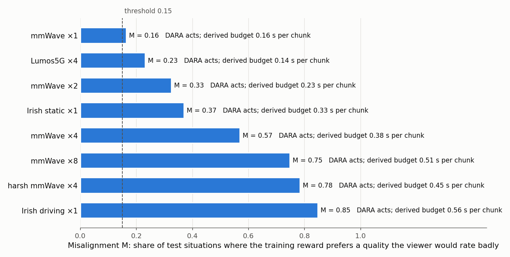

### 2. What happens if the agent is simply trained on the reward?

> On the easiest ladder (mmWave ×1) plain training already works (285 vs 293 for the best fixed quality).
> As chunks grow, plain training collapses: on mmWave ×8 it scores -262. Its average quality level there is 4.0 of 4 (almost always the top), so the video keeps freezing. DARA-L scores 100 there.

*How to read it.* Same network (mmWave generator), four chunk-size ladders. A negative score means freezing cost more than the picture quality earned.

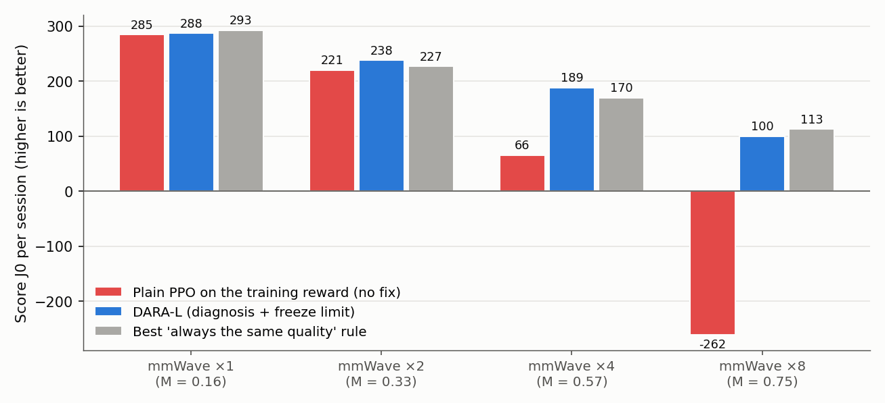

### 3. Can the diagnosis tell, before training, whether training will fail?

> Yes. Over 22 reward settings, the higher M was before training, the worse the trained agent did (rank correlation 0.87, 95% interval 0.78 to 0.92).
> Settings DARA flags (M ≥ 0.15) fell 93% short of the best fixed quality on average (over 100% means the score went negative); settings it passes fell 1.1% short.
> Caveat: 7 of 16 flagged settings lost less than 5% (all on mmWave ×1, mmWave ×2): a high M warns of failure but does not guarantee it.

*How to read it.* Each dot: one reward setting (ladder × how much the reward penalises freezing), trained with plain PPO on 5 seeds. Up = trained agent did badly. A good diagnosis puts the low dots left of the line and the high dots right of it.

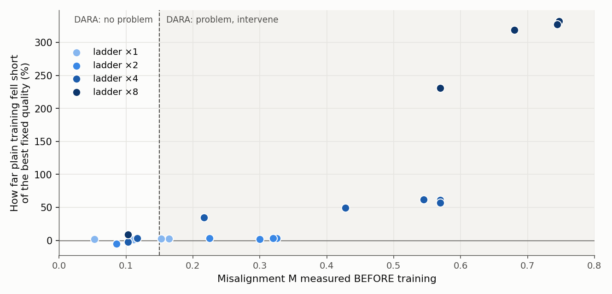

### 4. Overall: how close does each method get to the best possible result?

> DARA-L is within 5% of the best result in 5 of 8 environments (mmWave ×1, Lumos5G ×4, mmWave ×2, Irish static ×1, mmWave ×4).
> It falls more than 10% behind in 3: mmWave ×8 (77%), harsh mmWave ×4 (73%), Irish driving ×1 (74%).
> It has the highest mean of the five methods shown in 1 of 8 environments (mmWave ×1). Small gaps are often not statistically significant (chart 7).

*How to read it.* One row per training environment, easiest at the top (lowest M). 'The best result anyone achieved' is the highest mean score of any method or fixed rule we ran there, including every hand-picked budget and reward variant.

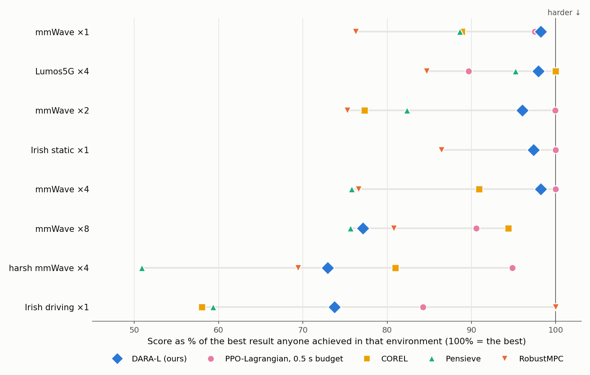

### 5. Does DARA-L choose a freeze budget as good as tuning it by hand?

> DARA-L picks a good budget in 5 of 8 environments where it acts, but misses in 3 (mmWave ×8, harsh mmWave ×4, Irish driving ×1).
> The misses are the hardest environments (M ≥ 0.75).
> Same rule as the pre-registered test, applied to this view (at least 3 hand-picked budgets): passes 3 of 5.
> In mmWave ×8, harsh mmWave ×4 the best hand-picked budget allowed more freezing than DARA-L's: the derived budget was too strict.

*How to read it.* PPO-Lagrangian is the same learner as DARA-L but with the freeze budget picked by hand; we trained several budgets per environment and took the best. DARA-L gets its budget from the diagnosis, with no tuning. Only environments where DARA acts are shown.

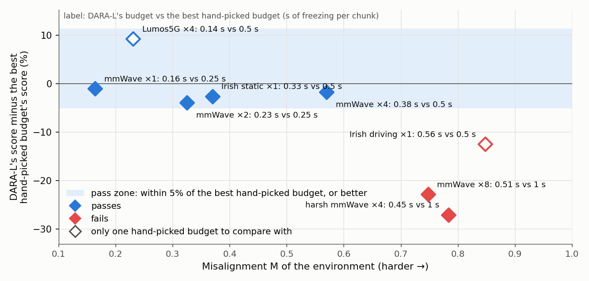

### 6. Why does DARA-L not beat a hand-picked budget of 0.5 s?

> The fixed 0.5 s budget is the strongest single competitor: it is the same learner, with a budget that happens to suit several of these environments.
> Where DARA-L scores lower (mmWave ×2, Irish static ×1, mmWave ×8, harsh mmWave ×4), it freezes LESS than PPO-Lagrangian but also picks lower quality: it is too cautious.
> A likely reason (exploratory): DARA switches the freeze limit on part-way through training, after the agent has learned to freeze a lot, and the limit's penalty weight then grows much larger than PPO-Lagrangian's (mmWave ×2: 4 vs 1, Irish static ×1: 4 vs 1, mmWave ×8: 11 vs 4, harsh mmWave ×4: 22 vs 3).
> Where a 0.5 s budget is wrong for the network, DARA-L's own budget helps: Lumos5G ×4 254 vs 232.

*How to read it.* Same rows as chart 4. Left: score; right: seconds of freezing per session. Each line joins the two methods in one environment; where only the diamond is visible, the two values are almost equal.

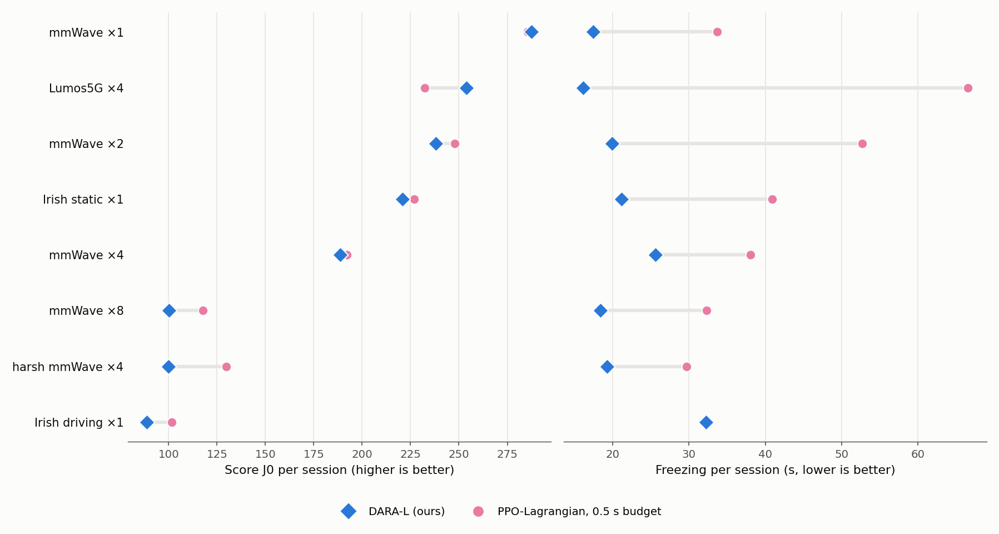

### 7. Which differences are real, and which could be chance?

> vs PPO-Lagrangian, 0.5 s budget: significantly better in 0 of 8, worse in 1, no difference in 0, unclear in 7.
> vs COREL: significantly better in 2 of 7, worse in 2, no difference in 0, unclear in 3.
> vs Pensieve: significantly better in 5 of 7, worse in 0, no difference in 2, unclear in 0.
> vs RobustMPC: significantly better in 5 of 8, worse in 1, no difference in 2, unclear in 0.

*How to read it.* Number = DARA-L's mean score minus the other method's. 'Significant' needs two tests to agree: one over the 100 test sessions and one that also accounts for the 5 training seeds. 'Unclear' usually means DARA-L wins most sessions by a little but loses a few by a lot, or the 5 training runs vary too much to tell.

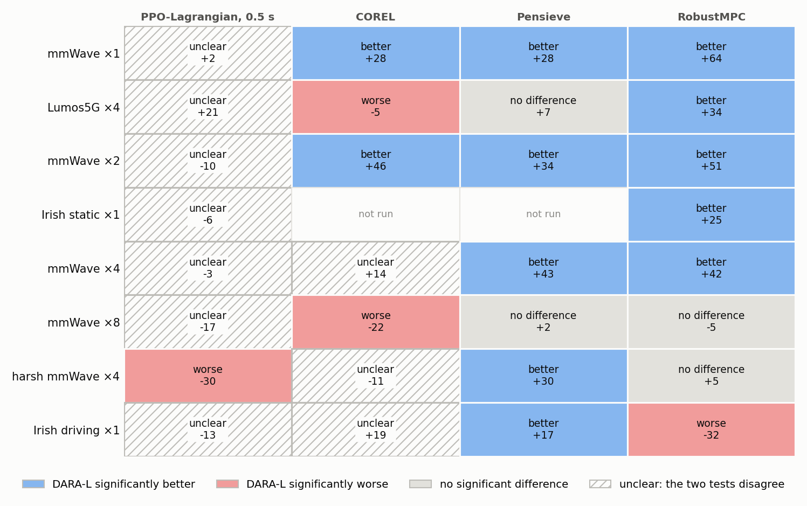

### 8. Do the models still work on networks and chunk sizes they never saw?

> On 11 unseen conditions DARA-L ranks 1st in 3, in the top two in 7, and last in 0 (average rank 2.4 of 5).
> PPO-Lagrangian, 0.5 s budget: average rank 2.8.
> COREL: average rank 2.9.
> Pensieve: average rank 4.3.
> RobustMPC: average rank 2.6.
> DARA-L ranks low (4th or 5th) on Irish 5G driving ×1, Irish 5G driving ×4, Irish 5G driving ×8.

*How to read it.* All five methods were trained once on the mmWave generator with ladder ×4, then tested without retraining. Number = mean score; rank 1st = best in that row. Lumos5G: real mmWave traces; Irish 5G: slower, mid-band 5G (a deliberately hard test). Scores can be negative when freezing dominates.

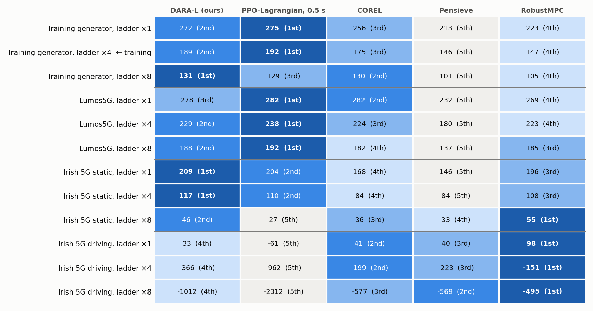

## Every method, environment by environment

### 9. mmWave ×1: mmWave generator, ladder ×1

> Top three by mean score: Always quality 4 (best fixed) (292.7), PPO-Lagrangian, 0.25 s (290.5), Plain PPO, cap 1 (290.1).
> DARA-L: 287.5 (seeds 280, 292, 288, 285, 292), freezing 17.4 s per session, average quality level 3.62 of 4, budget 0.157 s per chunk, DARA acted in 5/5 seeds.
> In the worst 5% of test sessions, PPO-Lagrangian, 0.5 s holds up best (95); DARA-L: 91.

*How to read it.* Every method trained in this environment, scored on the same 100 test sessions. (a) mean and each seed; (b) the score split into quality earned (sum of quality levels minus switching penalties) and the cost of freezing (1.075 per second); (c) how often each quality level was chosen (q0 lowest, q4 highest); (d) how the score varies across the 100 test sessions. Plain PPO, cap c = the reward variants without DARA.

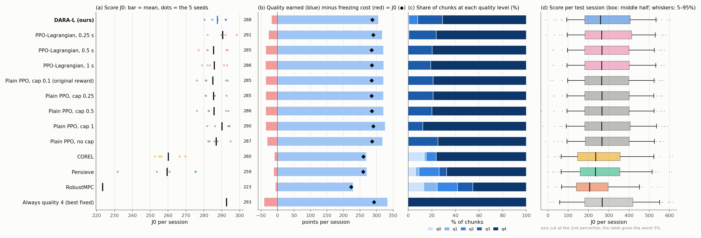

Numbers: [10_env_ct1.csv](10_env_ct1.csv)

### 10. Lumos5G ×4: Lumos5G traces, ladder ×4 (20% of traces held out)

> Top three by mean score: COREL (259.1), DARA-L (ours) (253.8), Pensieve (246.7).
> DARA-L: 253.8 (seeds 253, 252, 257, 256, 251), freezing 16.1 s per session, average quality level 3.47 of 4, budget 0.144 s per chunk, DARA acted in 5/5 seeds.
> In the worst 5% of test sessions, COREL holds up best (96); DARA-L: 86.

*How to read it.* Every method trained in this environment, scored on the same 100 test sessions. (a) mean and each seed; (b) the score split into quality earned (sum of quality levels minus switching penalties) and the cost of freezing (1.075 per second); (c) how often each quality level was chosen (q0 lowest, q4 highest); (d) how the score varies across the 100 test sessions. Plain PPO, cap c = the reward variants without DARA.

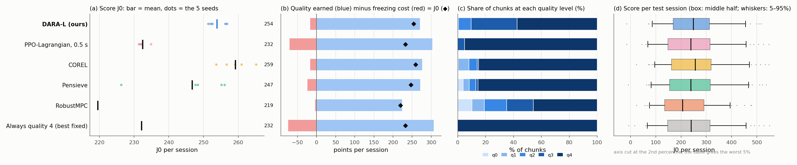

Numbers: [10_env_ctl.csv](10_env_ctl.csv)

### 11. mmWave ×2: mmWave generator, ladder ×2

> Top three by mean score: PPO-Lagrangian, 0.25 s (247.9), PPO-Lagrangian, 0.5 s (247.7), Plain PPO, no cap (239.7).
> DARA-L: 238.1 (seeds 227, 247, 231, 246, 239), freezing 19.9 s per session, average quality level 2.94 of 4, budget 0.231 s per chunk, DARA acted in 5/5 seeds.
> In the worst 5% of test sessions, DARA-L (ours) holds up best (64); DARA-L: 64.

*How to read it.* Every method trained in this environment, scored on the same 100 test sessions. (a) mean and each seed; (b) the score split into quality earned (sum of quality levels minus switching penalties) and the cost of freezing (1.075 per second); (c) how often each quality level was chosen (q0 lowest, q4 highest); (d) how the score varies across the 100 test sessions. Plain PPO, cap c = the reward variants without DARA.

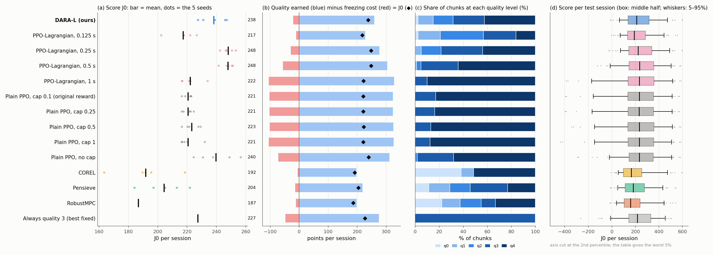

Numbers: [10_env_ct2.csv](10_env_ct2.csv)

### 12. Irish static ×1: Irish 5G static traces, ladder ×1

> Top three by mean score: PPO-Lagrangian, 0.5 s (226.9), DARA-L (ours) (220.9), PPO-Lagrangian, 0.25 s (207.3).
> DARA-L: 220.9 (seeds 215, 228, 223, 225, 213), freezing 21.1 s per session, average quality level 3.00 of 4, budget 0.327 s per chunk, DARA acted in 5/5 seeds.
> In the worst 5% of test sessions, PPO-Lagrangian, 0.5 s holds up best (71); DARA-L: 66.

*How to read it.* Every method trained in this environment, scored on the same 100 test sessions. (a) mean and each seed; (b) the score split into quality earned (sum of quality levels minus switching penalties) and the cost of freezing (1.075 per second); (c) how often each quality level was chosen (q0 lowest, q4 highest); (d) how the score varies across the 100 test sessions. Plain PPO, cap c = the reward variants without DARA.

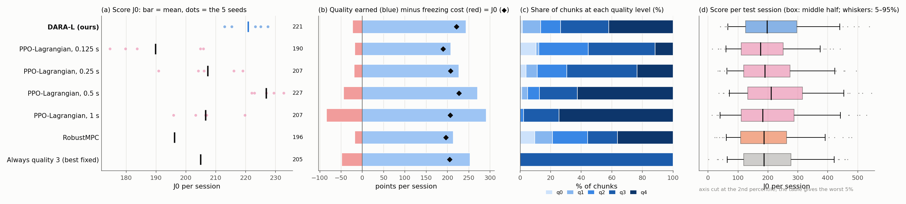

Numbers: [10_env_cts1.csv](10_env_cts1.csv)

### 13. mmWave ×4: mmWave generator, ladder ×4

> Top three by mean score: PPO-Lagrangian, 0.5 s (192.1), DARA-L (ours) (188.7), PPO-Lagrangian, 1 s (183.0).
> DARA-L: 188.7 (seeds 187, 190, 182, 192, 193), freezing 25.6 s per session, average quality level 2.21 of 4, budget 0.384 s per chunk, DARA acted in 5/5 seeds.
> In the worst 5% of test sessions, DARA-L (ours) holds up best (34); DARA-L: 34.

*How to read it.* Every method trained in this environment, scored on the same 100 test sessions. (a) mean and each seed; (b) the score split into quality earned (sum of quality levels minus switching penalties) and the cost of freezing (1.075 per second); (c) how often each quality level was chosen (q0 lowest, q4 highest); (d) how the score varies across the 100 test sessions. Plain PPO, cap c = the reward variants without DARA.

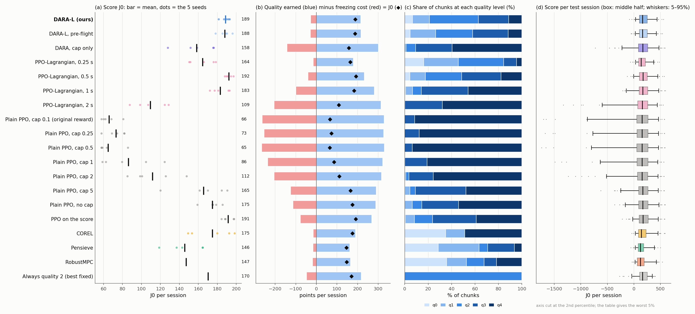

Numbers: [10_env_ct4.csv](10_env_ct4.csv)

### 14. mmWave ×8: mmWave generator, ladder ×8

> Top three by mean score: PPO-Lagrangian, 1 s (129.8), COREL (122.5), PPO-Lagrangian, 0.5 s (117.6).
> DARA-L: 100.2 (seeds 111, 108, 102, 86, 94), freezing 18.4 s per session, average quality level 0.65 of 4, budget 0.513 s per chunk, DARA acted in 5/5 seeds.
> In the worst 5% of test sessions, RobustMPC holds up best (-10); DARA-L: -11.

*How to read it.* Every method trained in this environment, scored on the same 100 test sessions. (a) mean and each seed; (b) the score split into quality earned (sum of quality levels minus switching penalties) and the cost of freezing (1.075 per second); (c) how often each quality level was chosen (q0 lowest, q4 highest); (d) how the score varies across the 100 test sessions. Plain PPO, cap c = the reward variants without DARA.

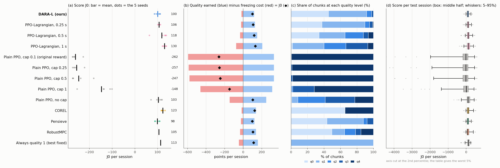

Numbers: [10_env_ct8.csv](10_env_ct8.csv)

### 15. harsh mmWave ×4: Harsh mmWave scenarios, ladder ×4

> Top three by mean score: PPO-Lagrangian, 1 s (136.9), PPO-Lagrangian, 0.5 s (129.8), Always quality 1 (best fixed) (117.0).
> DARA-L: 99.8 (seeds 119, 92, 99, 94, 95), freezing 19.3 s per session, average quality level 0.71 of 4, budget 0.453 s per chunk, DARA acted in 5/5 seeds.
> In the worst 5% of test sessions, Pensieve holds up best (-3); DARA-L: -20.

*How to read it.* Every method trained in this environment, scored on the same 100 test sessions. (a) mean and each seed; (b) the score split into quality earned (sum of quality levels minus switching penalties) and the cost of freezing (1.075 per second); (c) how often each quality level was chosen (q0 lowest, q4 highest); (d) how the score varies across the 100 test sessions. Plain PPO, cap c = the reward variants without DARA.

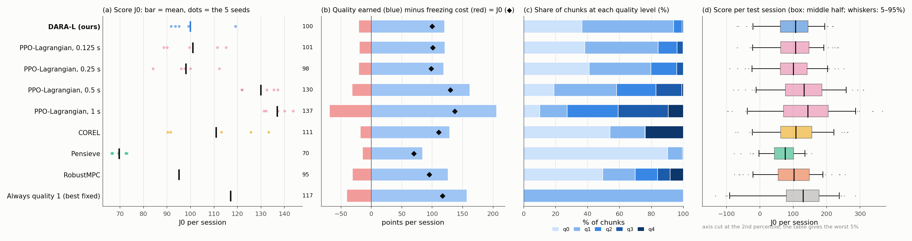

Numbers: [10_env_cth4.csv](10_env_cth4.csv)

### 16. Irish driving ×1: Irish 5G driving traces, ladder ×1 (4 of 16 traces held out)

> Top three by mean score: RobustMPC (120.5), PPO-Lagrangian, 0.5 s (101.5), DARA-L (ours) (88.8).
> DARA-L: 88.8 (seeds 83, 96, 102, 82, 80), freezing 32.2 s per session, average quality level 0.97 of 4, budget 0.561 s per chunk, DARA acted in 5/5 seeds.
> In the worst 5% of test sessions, PPO-Lagrangian, 0.5 s holds up best (-81); DARA-L: -85.

*How to read it.* Every method trained in this environment, scored on the same 100 test sessions. (a) mean and each seed; (b) the score split into quality earned (sum of quality levels minus switching penalties) and the cost of freezing (1.075 per second); (c) how often each quality level was chosen (q0 lowest, q4 highest); (d) how the score varies across the 100 test sessions. Plain PPO, cap c = the reward variants without DARA.

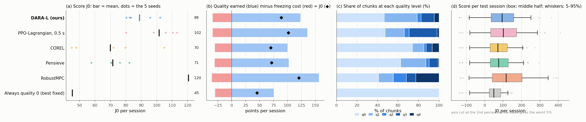

Numbers: [10_env_ctd1.csv](10_env_ctd1.csv)

## How training unfolded

### 17. How did the score develop during training?

> DARA switched the limit on at episode mmWave ×1 2000–4003; Lumos5G ×4 2001–2006; mmWave ×2 2000–2004; Irish static ×1 2001–2006; mmWave ×4 2000–2004; mmWave ×8 2000–2004; harsh mmWave ×4 2002–5000; Irish driving ×1 2001–3003 (of 10,000).
> Before that, DARA-L trains without any freeze limit, exactly like plain PPO.
> In that unconstrained phase DARA-L's training score falls far below PPO-Lagrangian's (lowest point: mmWave ×4 59 vs 118, mmWave ×8 -230 vs 0, harsh mmWave ×4 -231 vs 55, Irish driving ×1 -754 vs -18): the agent learns to stream at high quality and freeze.
> Over the last 1,000 episodes DARA-L minus PPO-Lagrangian 0.5 s on training sessions: mmWave ×1 -11, Lumos5G ×4 -2, mmWave ×2 -21, Irish static ×1 -35, mmWave ×4 -2, mmWave ×8 -19, harsh mmWave ×4 -49, Irish driving ×1 -11.

*How to read it.* Moving average of J0 on the sessions the agent trains on (not the test sessions), mean of 5 seeds with the min–max range shaded. The grey band marks the episodes at which DARA switched the freeze limit on (earliest to latest seed).

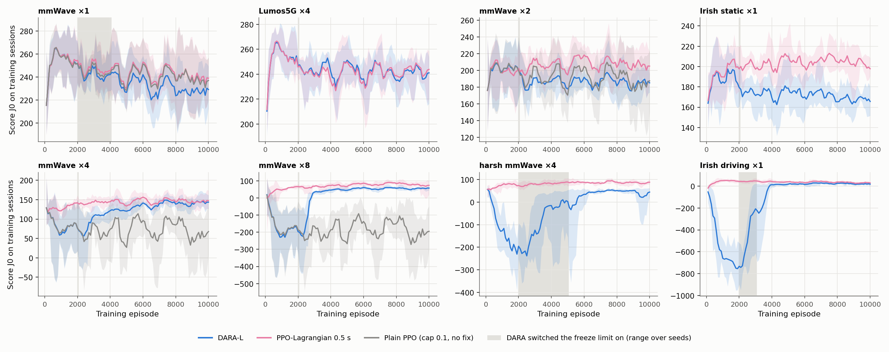

### 18. How strongly was freezing penalised as training went on?

> mmWave ×1: final λ 2.9 (DARA-L) vs 0.0
> Lumos5G ×4: final λ 1.6 (DARA-L) vs 0.1
> mmWave ×2: final λ 3.6 (DARA-L) vs 1.1
> Irish static ×1: final λ 3.6 (DARA-L) vs 1.1
> mmWave ×4: final λ 2.8 (DARA-L) vs 2.1
> mmWave ×8: final λ 10.8 (DARA-L) vs 3.5
> harsh mmWave ×4: final λ 21.4 (DARA-L) vs 2.9
> Irish driving ×1: final λ 38.9 (DARA-L) vs 13.6
> DARA-L's final λ is more than twice PPO-Lagrangian's in mmWave ×1, Lumos5G ×4, mmWave ×2, Irish static ×1, mmWave ×8, harsh mmWave ×4, Irish driving ×1. A large λ makes the agent avoid freezing at the cost of quality (exploratory reading, not a pre-registered test).

*How to read it.* λ is the weight the Lagrangian puts on freezing beyond the budget; it rises while the agent freezes more than allowed and falls when it freezes less. DARA-L's λ is 0 until DARA switches the limit on.

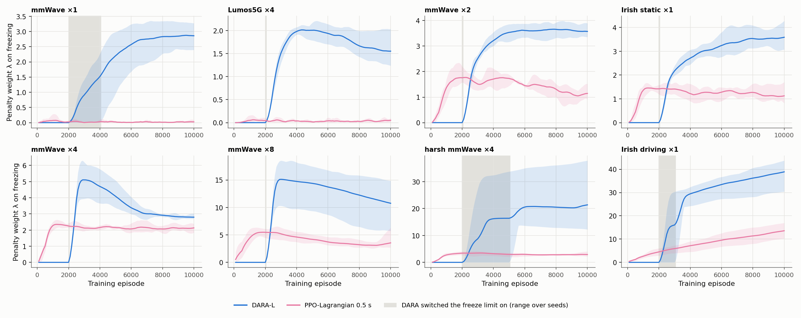

## Statistics in full

### 19. Every comparison with its confidence interval

> 79 comparisons: DARA-L better in 28, worse in 9, no difference in 10, unclear in 32.
> An interval that crosses 0 means the 5 seeds disagree too much to be sure of the direction, even when the per-session test is significant: that is what most 'unclear' verdicts are.

*How to read it.* Dot = DARA-L's mean score minus the method's (positive = DARA-L better); line = 95% bootstrap interval over seeds and sessions. Right: share of the 100 sessions where DARA-L scored higher, the per-session test (q, corrected for multiple comparisons) and the test over seed means (p_seed).

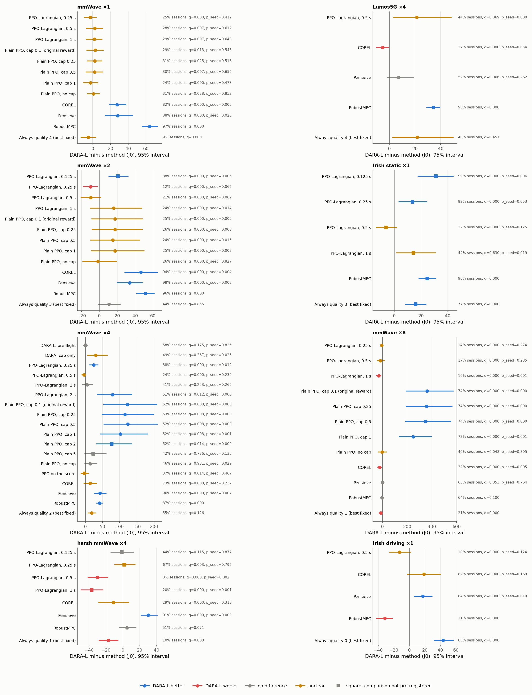

Numbers: [20_statistics.csv](20_statistics.csv)

## Budgets and reward settings

### 20. Score and freezing for every hand-picked budget

> mmWave ×1: DARA-L 288; a hand-picked budget equal to DARA-L's would score about 291 (interpolated), the best hand-picked one 291.
> mmWave ×2: DARA-L 238; a hand-picked budget equal to DARA-L's would score about 244 (interpolated), the best hand-picked one 248.
> mmWave ×4: DARA-L 189; a hand-picked budget equal to DARA-L's would score about 182 (interpolated), the best hand-picked one 192.
> mmWave ×8: DARA-L 100; a hand-picked budget equal to DARA-L's would score about 118 (interpolated), the best hand-picked one 130.
> Irish driving ×1: DARA-L 89; a hand-picked budget equal to DARA-L's would score about 102 (interpolated), the best hand-picked one 102.
> harsh mmWave ×4: DARA-L 100; a hand-picked budget equal to DARA-L's would score about 125 (interpolated), the best hand-picked one 137.
> Lumos5G ×4: DARA-L 254; a hand-picked budget equal to DARA-L's would score about 232 (interpolated), the best hand-picked one 232.
> Irish static ×1: DARA-L 221; a hand-picked budget equal to DARA-L's would score about 215 (interpolated), the best hand-picked one 227.
> Where DARA-L sits below the interpolated curve, the loss comes from how DARA-L trains (limit switched on late), not from the budget value itself.

*How to read it.* Top row of each pair: score; bottom row: freezing. The interpolated value is a straight line between the two nearest hand-picked budgets, so it is only a rough guide.

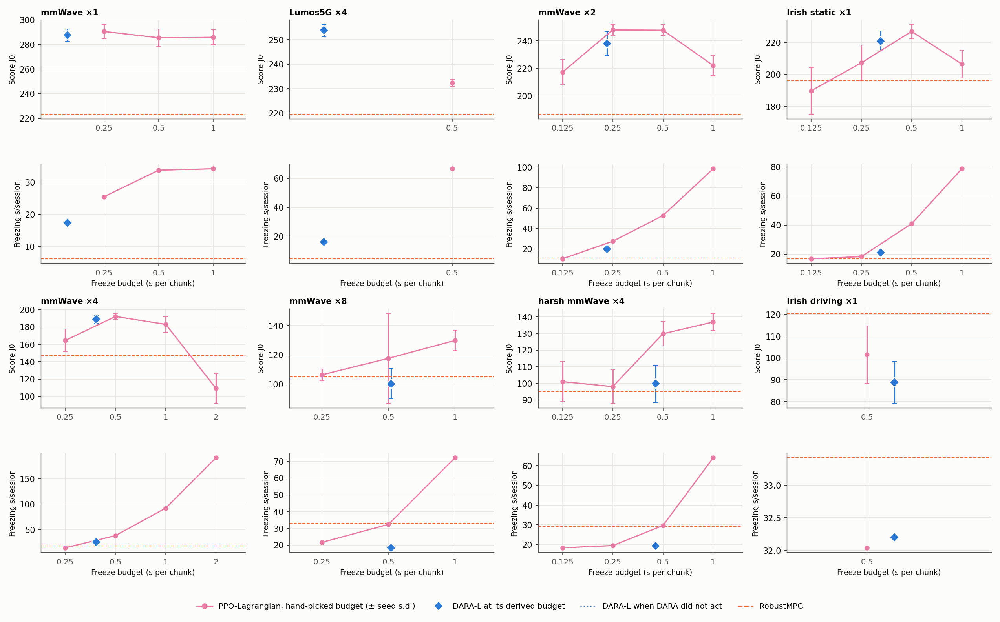

Numbers: [30_budget_curves.csv](30_budget_curves.csv)

### 21. What does the cap on the freezing penalty do to the reward and to training?

> Loosening or removing the cap lowers M and, in step, raises the plain-PPO score: the cap is what makes the reward ignore freezing.
> With no cap at all: ladder ×1 M 0.05, J0 287, ladder ×2 M 0.09, J0 240, ladder ×4 M 0.10, J0 175, ladder ×8 M 0.10, J0 103.

*How to read it.* Left: misalignment M before training for each cap. Right: the score plain PPO reaches with that reward; dotted lines are the best fixed quality on each ladder; diamonds at the right edge are DARA-L (which uses cap 0.1).

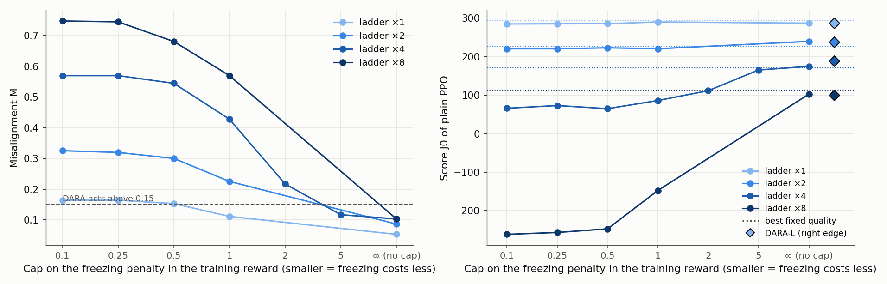

Numbers: [31_reward_caps.csv](31_reward_caps.csv)

## Unseen networks in detail

### 22. Score, freezing and quality on every unseen network and ladder

> Training generator: best per ladder: ×1 PPO-Lagrangian, 0.5 s budget, ×4 PPO-Lagrangian, 0.5 s budget, ×8 DARA-L (ours).
> Lumos5G: best per ladder: ×1 PPO-Lagrangian, 0.5 s budget, ×4 PPO-Lagrangian, 0.5 s budget, ×8 PPO-Lagrangian, 0.5 s budget.
> Irish 5G static: best per ladder: ×1 DARA-L (ours), ×4 DARA-L (ours), ×8 RobustMPC.
> Irish 5G driving: best per ladder: ×1 RobustMPC, ×4 RobustMPC, ×8 RobustMPC.

*How to read it.* Models trained on the mmWave generator with ladder ×4, tested without retraining. Each row is one test network, each column one measure; the x-axis is the chunk-size ladder.

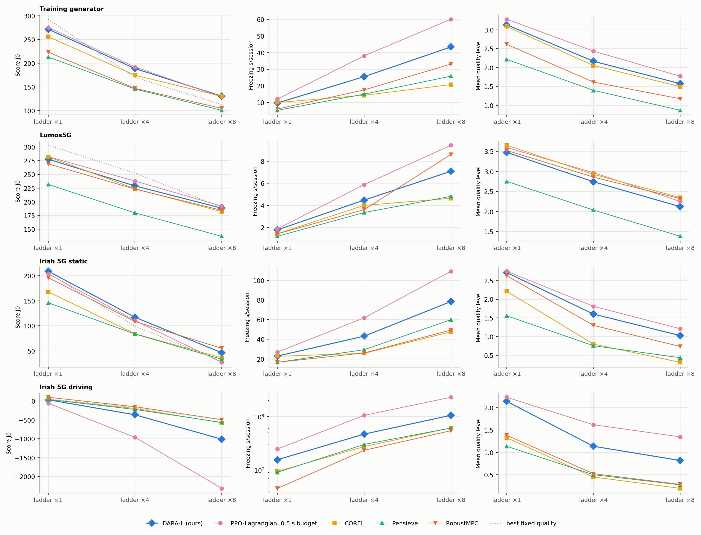

Numbers: [40_unseen_detail.csv](40_unseen_detail.csv)

### 23. On unseen networks, which differences are significant?

> 18 significantly better, 7 significantly worse, out of 48 comparisons.

*How to read it.* As chart 7, for the unseen test conditions.

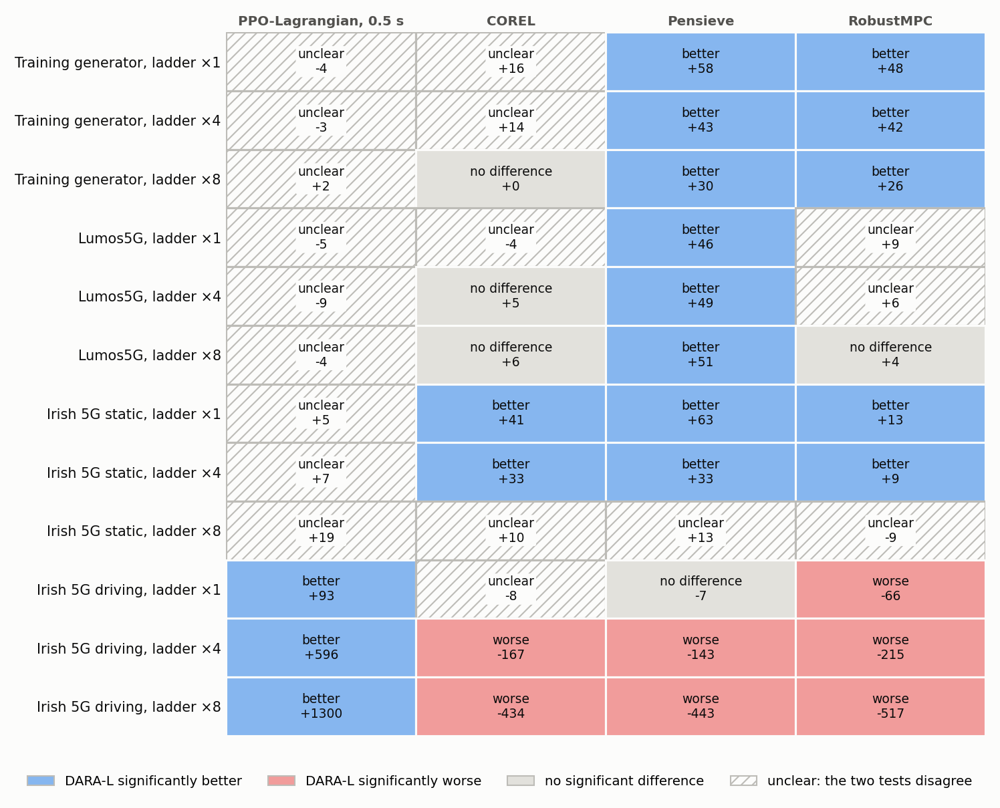

Numbers: [41_unseen_significance.csv](41_unseen_significance.csv)

## The networks

### 24. How fast are the networks used for training and testing?

> Median throughput: training generator 106 Mbit/s, Lumos5G 424, Irish 5G driving 9.
> Dashed lines: bitrate of the lowest and highest quality on each ladder. Where most of a network's bar is left of a quality's line, that quality cannot be sustained.

*How to read it.* Generator rows are synthetic sessions of the mmWave generator (training mix and selected scenarios); Lumos5G is real mmWave; Irish 5G is real mid-band 5G.

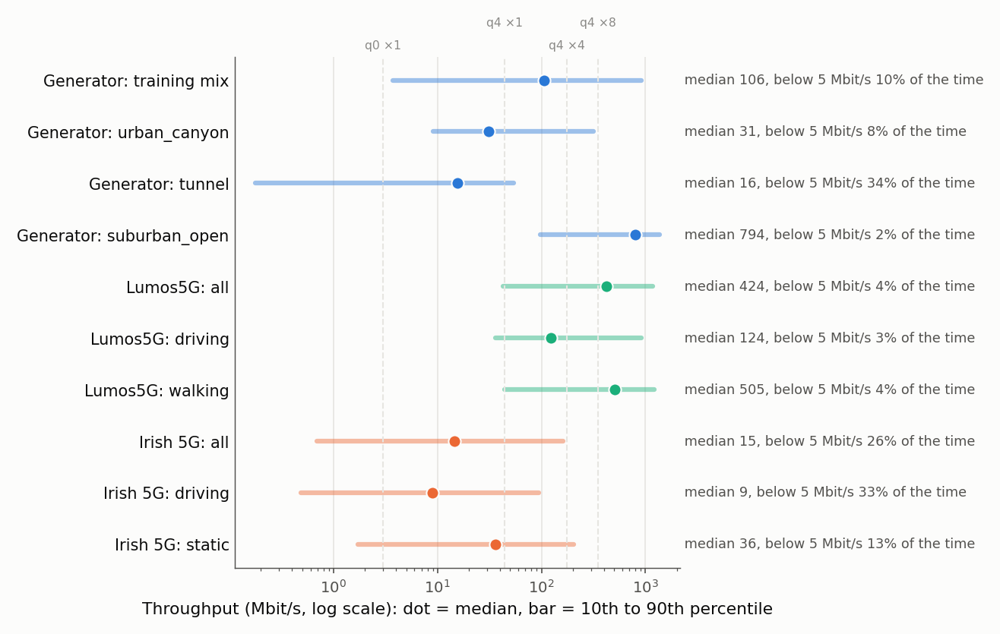

Numbers: [50_networks.csv](50_networks.csv)

### 25. How often can each network carry each quality level?

> Share of seconds in which the network is at least as fast as the quality level's bitrate. Bigger ladders push every quality's bitrate up, so the shares shrink from left to right: this is why ×8 is hard.

*How to read it.* Rows: networks; columns: the five quality levels with their bitrate (Mbit/s) on that ladder.

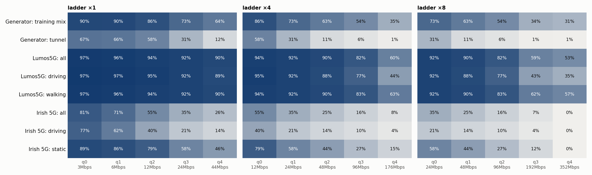
